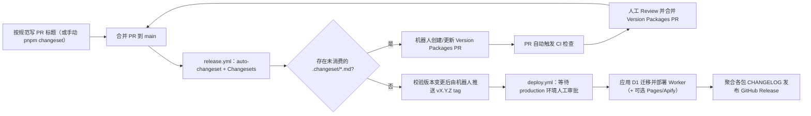

# 发版与自动部署指南

本仓库采用 **GitHub App 机器人 + Changesets** 的自动化发版体系，并在 `v*` tag 触发后执行受审批保护的生产环境部署（Cloudflare Workers / D1 / 可选 Pages Hook 与 Apify）及 GitHub Release 发布。

## 整体流程



> **为什么需要 GitHub App Token？**
> GitHub 默认限制由 `GITHUB_TOKEN` 触发的动作（例如开 PR、推 tag）**不会触发其他 workflow**。改用 GitHub App 生成的安装令牌后，机器人开启的 `Version Packages` PR 会正常触发 CI 检查，机器人推送的 `v*` tag 也会正常触发 `deploy.yml`。

---

## 日常开发与发版操作

1. **平时提 PR 不用手动写 `.changeset`**：只要 PR 标题或提交信息遵循常规提交规范（Conventional Commits），合并到 `main` 后机器人会自动识别：
   - `feat: ...` → 升 **minor** 版本（例如 `0.1.1` → `0.2.0`）
   - `fix: ...` / `perf: ...` / `revert: ...` → 升 **patch** 版本（例如 `0.1.1` → `0.1.2`）
   - `feat!: ...` 或提交正文含 `BREAKING CHANGE:` → 升 **major** 版本
   - `docs:` / `chore:` / `ci:` / `test:` / `style:` / `refactor:` → **不触发发版**
   - 如需自定义更详细的 Release 说明，仍可在 PR 中运行 `pnpm changeset` 手动生成 `.changeset/*.md`（同一提交存在手动 changeset 时优先采用手动文件）。
2. PR 合并到 `main` 后：
   - `.github/workflows/release.yml` 会自动读取自上次发版 tag 以来新增的 PR 标题/提交并生成变更条目，随即由机器人打开或更新 `chore(release): version packages` PR。
   - 若尚未合并 `Version Packages` PR，后续继续合并的 `feat:` / `fix:` PR 会自动汇总追加到同一个 `Version Packages` PR 中。
   - 该 PR 会同步更新各包版本、根 `package.json` 版本、`apps/apify-crawler/package-lock.json`、`apps/apify-crawler/.actor/actor.json`（不低于现有 `1.0`）以及各包 `CHANGELOG.md`。
3. 需要正式发版时，只需**合并 `Version Packages` PR** 到 `main`：
   - `release.yml` 再次运行，检测到无待处理 changeset 且远端尚无当前版本号对应的 tag（且非基线版本），即自动打 `vX.Y.Z` tag 并推送。
4. `deploy.yml` 被 `v*` tag 触发，并在 `production` 环境暂停等待审批：
   - 在 GitHub Actions 运行页批准 `production` 部署后，自动执行 D1 远端迁移、Worker 部署，以及可选的 Pages Deploy Hook 与 Apify Push。
   - 部署成功后自动发布对应 `vX.Y.Z` 的 GitHub Release。

---

## 一次性配置清单（需在 GitHub / Cloudflare 网页端完成）

### 1. 创建并安装 GitHub App（与 biliup 仓库共用同一个即可）

1. 打开 GitHub **Settings → Developer settings → GitHub Apps → New GitHub App**。
2. 填写基础信息：
   - **GitHub App name**：全局唯一名称（例如 `pingshazi-release-bot`）。
   - **Homepage URL**：可填任意一个仓库地址。
3. **Webhook**：**取消勾选 Active**（本方案不需要接收 Webhook）。
4. **Repository permissions**：
   - **Contents**：`Read and write`
   - **Pull requests**：`Read and write`
   - （`Metadata` 只读会自动包含）
5. **Where can this GitHub App be installed?**：选择 **Only on this account**。
6. 点击 **Create GitHub App** 后：
   - 记录页面上的 **Client ID**（注意不是 App ID，workflow 使用 `client-id`）。
   - 向下滚动点击 **Generate a private key**，保存下载的 `.pem` 私钥文件。
7. 在左侧栏点 **Install App**，安装到你的账号下，建议选择 **Only select repositories** 并勾选 `zhihu-backup`（及 `biliup-1.0.7`）。

### 2. 配置 Repository Secrets

在 `zhihu-backup` 仓库 **Settings → Secrets and variables → Actions → Repository secrets** 添加：

- `RELEASE_APP_CLIENT_ID`：上一步记录的 GitHub App Client ID。
- `RELEASE_APP_PRIVATE_KEY`：下载的 `.pem` 文件完整内容。

也可以用 GitHub CLI 写入（请替换为实际值与路径）：

```bash
gh secret set RELEASE_APP_CLIENT_ID -R pingshazikdjnd/zhihu-backup -b "<你的Client_ID>"
gh secret set RELEASE_APP_PRIVATE_KEY -R pingshazikdjnd/zhihu-backup < "<私钥.pem路径>"
```

同时确保仓库 **Settings → Actions → General → Workflow permissions** 保持默认即可，不必放宽全部权限；若希望 Actions 能代表流程开 PR，确认没有禁用 GitHub Actions 创建 PR。

### 3. 配置 `production` Environment 与云端密钥

1. 打开仓库 **Settings → Environments → New environment**，新建名为 **`production`** 的环境。
2. 勾选 **Required reviewers**，添加**你自己**作为审批人并保存（防止误推 tag 直接改动线上 D1）。
3. 在 `production` 环境的 **Environment secrets** 中添加：
   - `CLOUDFLARE_API_TOKEN`：在 Cloudflare 创建自定义 Token，建议基于 **Edit Cloudflare Workers** 模板并补充 **D1 → Edit** 权限。
   - `CLOUDFLARE_ACCOUNT_ID`：Cloudflare 控制台右侧栏显示的 Account ID。
   - 若暂未配置上述 Cloudflare 密钥，`deploy.yml` 会自动跳过 Worker 与 D1 部署并继续发布 GitHub Release（便于先验证发版机器人链路）。
4. **（可选）Pages 部署联动 `CF_PAGES_DEPLOY_HOOK`**：
   - 当前 Pages 默认通过 Cloudflare Git 集成随 `main` 自动部署，因此未配置此项时会跳过且不影响流程。
   - 如果希望前端仅在审批发版后与 Worker 同步上线：前往 Cloudflare Pages 项目 **Settings → Builds & deployments** 关闭 `main` 分支的自动生产构建，然后在 **Deploy hooks** 新建一个指向 `main` 分支的 Hook URL，写入 `production` 环境 secret `CF_PAGES_DEPLOY_HOOK`。
5. **（可选）云端 Apify Actor 同步**：
   - 当前项目默认停用云端 Apify 定时任务（`crons = []`），因此默认不会推送 Apify。
   - 如需恢复自动推送，在 `production` 环境 secret 添加 `APIFY_TOKEN`，并在仓库或环境 **Variables** 中添加 `APIFY_DEPLOY` = `true`。

---

## 常见异常与恢复

- **部署失败（网络抖动、审批超时或漏配 Secret）**：
  修复配置后，直接在失败的 `Deploy` workflow 页面点击 **Re-run all jobs**；或在 GitHub Actions 手动运行 `Deploy` workflow，并在 **Use workflow from** 下拉框切换为对应的 `vX.Y.Z` tag。
- **`Version Packages` PR 已合并但因故未打上 tag**：
  在 GitHub Actions 手动运行 `Release` workflow（分支选 `main`），勾选 **`force_tag`** 选项即可补打当前根版本对应的 `vX.Y.Z` tag 并触发部署（若远端已存在同名 tag 会自动安全跳过）。
- **GitHub Release 残留草稿导致中断**：
  `.github/scripts/publish-release.sh` 在重跑时会自动清理未发布成功的同名草稿并重新创建；已正式发布的 Release 则会自动跳过。

> 说明：仓库根目录的历史 [更新日志](../CHANGELOG.md) 保持手工归档不变，后续版本变更自动记录在 `apps/*/CHANGELOG.md` 与 `packages/shared/CHANGELOG.md` 中，并在发布 GitHub Release 时自动聚合展示。
